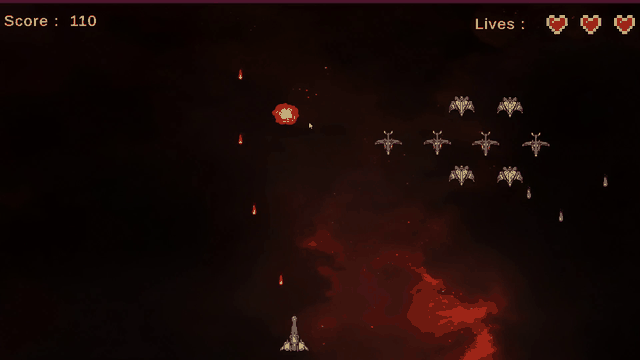
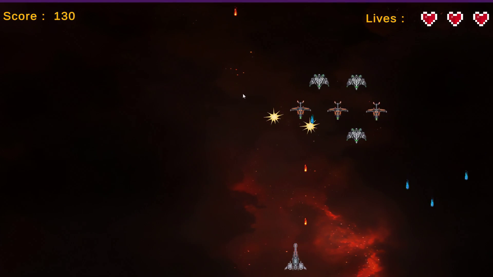
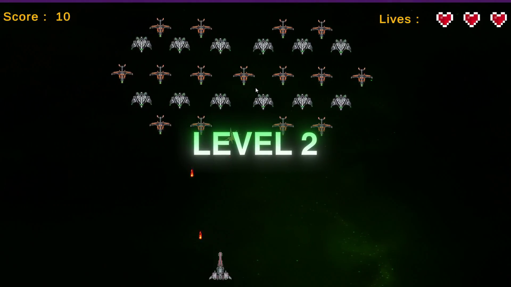
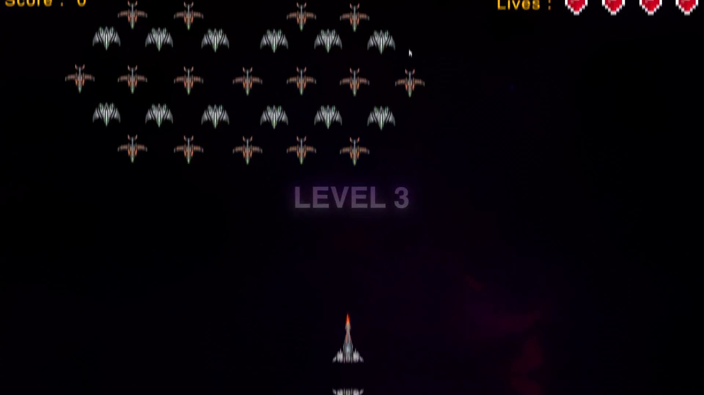
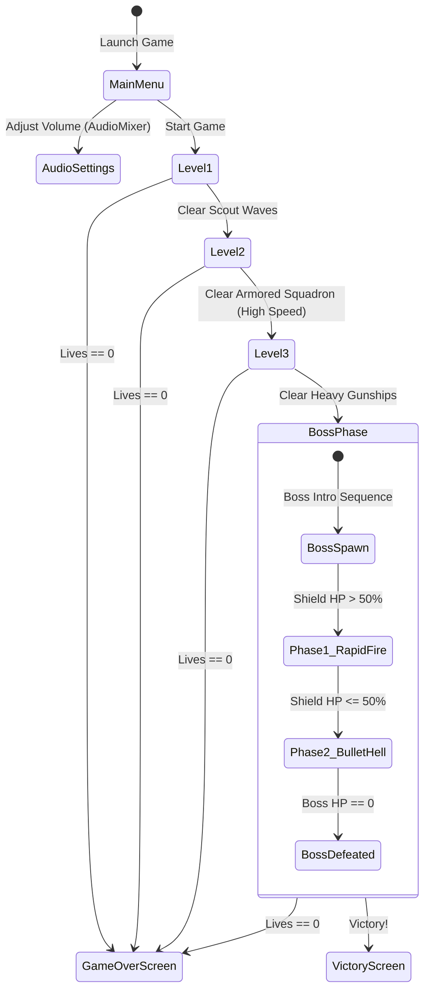

# Nistal Invaders (Galaxy Invaders) 👾🚀

> **A complete 2D arcade space shooter developed in Unity 2022 & C#. Features escalating enemy wave patterns, multi-phase boss mechanics, real-time AudioMixer integration, and a standalone Windows installer.**

---

## 🎬 Real Gameplay Demonstration

  
   
  <em>Figure 1: In-game footage capturing wave combat, diagonal projectile firing, heart health HUD, and dynamic score tracking.</em>

---

## 🕹️ Quickstart & How to Play

### 1. Standalone Executable (Windows)
Play immediately without opening Unity:
1. Run the included setup installer: [`GalaxyInvader-setup.exe`](GalaxyInvader-setup.exe)
2. Follow the standard installation wizard.
3. Launch **Nistal Invaders** directly from your Desktop or Start Menu.

### 2. Unity Editor (Source Code)
1. Requires **Unity 2022.3.14f1 LTS** or later.
2. Open **Unity Hub** -> **Add project from disk** -> Select folder `NistaLInvaders`.
3. Open the entry scene: `Assets/Scenes/MenuInitial.unity` and click **Play**.

### Controls
| Action | Primary Key | Alternate Input |
|---|---|---|
| **Move Left / Right** | `←` / `→` | `A` / `D` |
| **Fire Laser Cannon** | `Spacebar` | Left Mouse Click |
| **Diagonal Spread Shot** | `Q` / `E` | Contextual trigger |
| **Pause Menu** | `Escape` | `P` |

---

## 📸 In-Game Screenshots

  
  
  

---

## ⚔️ Game Loop & Level Progression

### Progression Design
- **Level 1 (Orbital Infiltration):** Introduces linear flight patterns and basic single-shot enemies.
- **Level 2 (Asteroid Belt Ambush):** Increased enemy density, variable descent velocity, and aggressive projectile trajectories.
- **Level 3 (Heavy Vanguard):** Multi-hit shielded gunships requiring timed player maneuvers.
- **Level 4 (Capital Mothership - Boss Fight):** Multi-phase boss battle with sweeping laser arrays, tracking missiles, dynamic health bar, and distinct attack phase transitions.

---

## 🏗️ Technical Implementation & Architecture

- **State Management & Decoupling:** Singleton `GameManager` coordinates score, live tracking, level transitions, and high-score persistence without hard-coupling to enemy prefabs.
- **Audio Architecture:** Real-time dynamic volume attenuation implemented via Unity's `AudioMixer` with dedicated sub-busses for SFX, Laser Blasts, Explosions, and Ambient Synthwave Music.
- **Object Pooling Principles:** High-frequency projectile instantiation leverages prefab recycling patterns to eliminate garbage collection spikes during dense bullet-hell phases.
- **Input System:** Responsive horizontal axis clamping keeps the player ship strictly bounded inside screen viewport coordinates across multiple aspect ratios (16:9, 16:10).

---

## 🎨 Asset Licensing & Third-Party Credits

All visual and sound assets are licensed for indie game development via the Unity Asset Store:
- [Puzzle Stage & Settings GUI Pack](https://assetstore.unity.com/packages/2d/gui/puzzle-stage-settings-gui-pack-147389)
- [Simple Heart Health System](https://assetstore.unity.com/packages/tools/gui/simple-heart-health-system-120676)
- [Pew Pew Template](https://assetstore.unity.com/packages/templates/tutorials/pew-pew-89318)
- [2D Flat Explosion Pack](https://assetstore.unity.com/packages/2d/textures-materials/2d-flat-explosion-66932)
- [2D Space Kit](https://assetstore.unity.com/packages/2d/environments/2d-space-kit-27662)
- [Pixel Art Space Ship Series](https://assetstore.unity.com/packages/2d/characters/pixel-art-space-ship-part-1-228832)

---

## 👤 Author & Maintainer

- **Iker Nistal Fernandez** ([@Niistal](https://github.com/Niistal))

---

## 📄 License & Transparency Notice

This repository is a public showcase of an interactive game engine project. The full raw Unity source project is not distributed. All rights reserved unless explicitly stated otherwise. See [`LICENSE`](LICENSE) for details.

> **About:** This repository serves exclusively as a technical portfolio showcase demonstrating game loop architecture, state machine orchestration, and dynamic audio design. Assets and third-party textures are credited to their respective Unity Asset Store authors.
